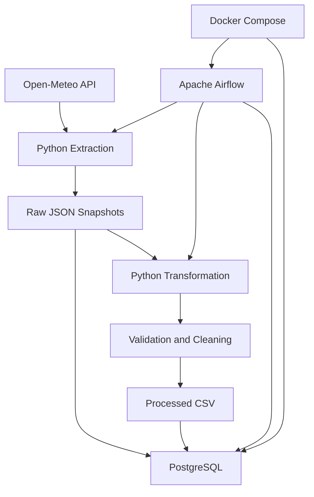

# Weather Data Engineering Pipeline

A production-style ETL pipeline that extracts weather forecast data from the Open-Meteo API, stores raw JSON snapshots, transforms the data using Python and Pandas, and loads structured records into PostgreSQL. The workflow is containerized with Docker and orchestrated using Apache Airflow.

## Project Overview

This project demonstrates an end-to-end data engineering workflow, including:

- API-based data ingestion
- Raw data persistence and traceability
- Data transformation and validation
- PostgreSQL database loading
- Idempotent data processing using UPSERT
- Workflow orchestration with Apache Airflow
- Containerization using Docker and Docker Compose
- Task-to-task data passing using Airflow XCom
- Automated transformation tests using Pytest

**Data source:** Open-Meteo API
**Forecast location:** Delhi, India

## Architecture



### Pipeline Workflow

1. **Extract:** Python requests weather forecast data from Open-Meteo.
2. **Store raw data:** API responses are saved as timestamped JSON snapshots.
3. **Transform:** Pandas converts the daily forecast arrays into structured records.
4. **Validate:** Checks cover required fields, matching array lengths, duplicates, numeric values and precipitation constraints.
5. **Save processed data:** Validated records are written to timestamped CSV files.
6. **Load:** Raw JSON is stored in PostgreSQL, while transformed records are inserted or updated in the daily weather table.
7. **Orchestrate:** Airflow coordinates extraction, transformation and loading in dependency order.

## Technology Stack

| Category | Technologies |
|---|---|
| Programming | Python |
| Data processing | Pandas |
| API ingestion | Open-Meteo, Requests |
| Database | PostgreSQL |
| Database connectivity | SQLAlchemy, Psycopg2 |
| Orchestration | Apache Airflow |
| Containerization | Docker, Docker Compose |
| Testing | Pytest |
| Data formats | JSON, CSV |

## Repository Structure

```text
weather-data-pipeline/
│
├── airflow-local/
│   ├── Dockerfile
│   ├── docker-compose.yaml
│   └── .env.example
│
├── dags/
│   └── weather_etl_dag.py
│
├── src/
│   ├── __init__.py
│   ├── config.py
│   ├── ingest.py
│   ├── transform.py
│   ├── load.py
│   └── pipeline.py
│
├── sql/
│   └── schema.sql
│
├── tests/
│   └── test_transform.py
│
├── data/
│   ├── raw/
│   └── processed/
│
├── .env.example
├── .gitignore
├── docker-compose.yml
├── requirements.txt
└── airflow-requirements.txt
```

## Database Design

The pipeline uses two PostgreSQL tables.

### 1. raw_weather

Stores raw API response snapshots in JSONB format.

- `snapshot_id`: Unique snapshot identifier.
- `payload`: Original API response.

This provides a historical record of ingested source data.

### 2. daily_weather

Stores structured daily weather forecasts.

| Column | Description |
|---|---|
| forecast_date | Forecast date and primary key |
| temp_max_c | Maximum temperature |
| temp_min_c | Minimum temperature |
| precipitation_mm | Daily precipitation |
| ingested_at_utc | UTC ingestion timestamp |

### Idempotent Loading

The daily weather table uses PostgreSQL `INSERT ... ON CONFLICT DO UPDATE`.

This ensures that repeated processing of the same forecast dates updates existing records rather than creating duplicates.

The raw snapshot table remains append-only, preserving individual ingestion records.

## Airflow Orchestration

The Airflow DAG is named `weather_etl_pipeline`.

It contains three tasks:

```text
extract_weather
       |
       v
transform_weather
       |
       v
load_weather
```

### Task Responsibilities

**extract_weather**
- Calls the ingestion module.
- Retrieves the API response.
- Saves the raw JSON snapshot.
- Returns the raw file path through XCom.

**transform_weather**
- Receives the raw file path through XCom.
- Executes the transformation module.
- Saves the processed CSV.
- Returns the processed file path through XCom.

**load_weather**
- Receives both file paths through XCom.
- Loads the raw JSON and transformed CSV into PostgreSQL.

The DAG is configured with retries, execution timeouts and a daily schedule.

## Local Setup

### Prerequisites

- Python 3.9 or compatible version supported by the dependencies
- Docker Desktop
- Docker Compose
- Git

### 1. Clone the repository

```bash
git clone <YOUR_GITHUB_REPOSITORY_URL>
cd weather-data-pipeline
```

### 2. Configure environment variables

Create the root environment file:

```bash
cp .env.example .env
```

Create the Airflow environment file:

```bash
cp airflow-local/.env.example airflow-local/.env
```

Configure secure credentials in both files.

Important: `WEATHER_DB_PASSWORD` in the Airflow environment must match `POSTGRES_PASSWORD` in the root environment. `AIRFLOW_DB_PASSWORD` is a separate credential for Airflow's metadata database.

Generate a Fernet key using:

```bash
python -c "from cryptography.fernet import Fernet; print(Fernet.generate_key().decode())"
```

Generate secure random passwords and an API JWT secret independently. Never commit actual environment files.

### 3. Start the weather PostgreSQL database

From the project root:

```bash
docker compose up -d postgres
```

Initialize the database schema:

```bash
docker exec -i weather-postgres psql \
  -U weather_user \
  -d weather_db < sql/schema.sql
```

### 4. Prepare the Airflow network

Create the shared Docker network if it does not already exist:

```bash
docker network create weather-network
```

Connect the weather database container:

```bash
docker network connect weather-network weather-postgres
```

If the network or connection already exists, Docker may report that it already exists.

### 5. Build the Airflow image

From the project root:

```bash
docker build \
  -f airflow-local/Dockerfile \
  -t weather-airflow:3.3.2 .
```

### 6. Start Airflow

Move into the Airflow directory:

```bash
cd airflow-local
```

Initialize Airflow if required by the Compose setup:

```bash
docker compose up airflow-init
```

Start the Airflow services:

```bash
docker compose up -d
```

Access the Airflow interface:

```text
http://localhost:8080
```

Use the Airflow web credentials configured in the environment file.

## Running the Pipeline

The DAG is named:

```text
weather_etl_pipeline
```

Enable and trigger the DAG from the Airflow interface.

The three tasks execute in dependency order:

1. Extract weather data.
2. Transform and validate the data.
3. Load records into PostgreSQL.

## Running Tests

From the project root, activate your Python virtual environment and run:

```bash
pytest -v
```

The transformation test suite contains nine passing tests covering the implemented validation and transformation logic.

## Verification

The completed pipeline was validated using the following checks:

- All three Airflow tasks completed successfully.
- Raw JSON snapshots were stored in PostgreSQL.
- Eight daily forecast records were loaded during final validation.
- Eight distinct forecast dates were present.
- Repeated loading maintained eight daily records, demonstrating idempotent UPSERT behaviour.

## Engineering Challenges and Lessons

### PostgreSQL authentication across Docker containers

The project uses separate PostgreSQL databases for weather application data and Airflow metadata.

A credential mapping error initially caused the Airflow worker to authenticate using the metadata database password instead of the weather database password.

The issue was resolved by correcting the Docker Compose environment variable mapping and synchronizing the weather database user's password.

### Persistent database credentials

Changing environment variables does not automatically update an existing PostgreSQL user's password in a persistent database volume.

The database user's password had to be updated separately.

### Airflow XCom and file-based task communication

The extraction and transformation tasks return file paths through XCom. Downstream tasks use those paths to process the exact files generated by upstream tasks.

### Idempotent database loading

PostgreSQL UPSERT logic ensures repeated processing does not create duplicate daily forecast records.

## Future Improvements

Potential extensions include:

- Cloud object storage for raw data.
- Cloud-hosted PostgreSQL or a data warehouse.
- Data quality monitoring and alerting.
- Logging and operational monitoring.
- CI/CD integration.
- Additional weather locations and historical analysis.

## Project Outcome

This project demonstrates practical experience with API ingestion, Python ETL development, data validation, PostgreSQL, Docker, Apache Airflow orchestration, XCom communication, automated testing and idempotent data loading.