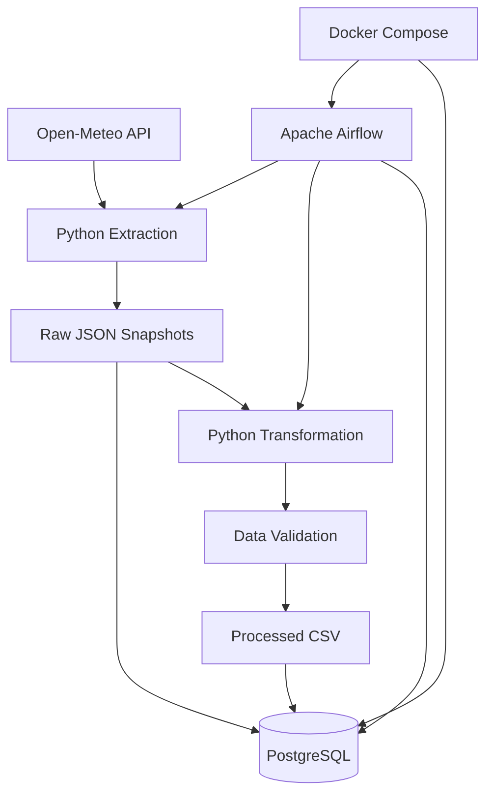

# Weather Data Engineering Pipeline

An end-to-end, production-style ETL pipeline that extracts weather forecast data from the Open-Meteo API, preserves raw JSON snapshots, transforms and validates the data using Python and Pandas, and loads structured records into PostgreSQL.

The pipeline is containerized with Docker and orchestrated using Apache Airflow.

**Technology stack:** Python · Pandas · PostgreSQL · Apache Airflow · Docker · SQLAlchemy · Pytest

## Project Overview

This project demonstrates an end-to-end data engineering workflow:

- REST API data ingestion
- Timestamped raw JSON persistence
- Data transformation and validation
- PostgreSQL database loading
- Idempotent processing using UPSERT
- Workflow orchestration using Apache Airflow
- Docker-based containerization
- Task communication through Airflow XCom
- Automated transformation testing using Pytest

**Data source:** Open-Meteo API  
**Forecast location:** Delhi, India  
**Forecast window:** 7 days

## Architecture



## Pipeline Workflow

1. **Extract:** Fetch weather forecast data from Open-Meteo using Python Requests.
2. **Store:** Save the original API response as a uniquely timestamped JSON snapshot.
3. **Transform:** Convert daily API arrays into structured Pandas DataFrame records.
4. **Validate:** Check required fields, array lengths, duplicate dates, numeric values, precipitation and temperature constraints.
5. **Export:** Save validated records as CSV files.
6. **Load:** Insert raw JSON into PostgreSQL JSONB and upsert processed daily records.
7. **Orchestrate:** Use Airflow to execute extraction, transformation and loading in dependency order.

## Technology Stack

| Category | Technologies |
|---|---|
| Programming | Python |
| Data processing | Pandas |
| API ingestion | Open-Meteo, Requests |
| Database | PostgreSQL |
| Database connectivity | SQLAlchemy, Psycopg2 |
| Orchestration | Apache Airflow |
| Containerization | Docker, Docker Compose |
| Testing | Pytest |
| Data formats | JSON, CSV |

## Repository Structure

```text
weather-data-engineering-pipeline/
│
├── airflow-local/
│   ├── Dockerfile
│   ├── docker-compose.yaml
│   └── .env.example
│
├── dags/
│   └── weather_etl_dag.py
│
├── src/
│   ├── config.py
│   ├── ingest.py
│   ├── transform.py
│   ├── load.py
│   └── pipeline.py
│
├── sql/
│   └── schema.sql
│
├── tests/
│   └── test_transform.py
│
├── .env.example
├── .gitignore
├── docker-compose.yml
├── requirements.txt
└── airflow-requirements.txt
```

## Database Design

The pipeline uses two PostgreSQL tables.

### 1. raw_weather

Stores original API response snapshots using JSONB.

| Column | Description |
|---|---|
| snapshot_id | Unique generated snapshot identifier |
| source_name | Source API name |
| payload | Original API response in JSONB |
| fetched_at | Database insertion timestamp |

The table preserves individual ingestion snapshots.

### 2. daily_weather

Stores structured daily forecast records.

| Column | Description |
|---|---|
| forecast_date | Forecast date and primary key |
| temp_max_c | Maximum temperature |
| temp_min_c | Minimum temperature |
| precipitation_mm | Daily precipitation |
| ingested_at_utc | UTC ingestion timestamp |

### Idempotent Loading

The daily weather table uses PostgreSQL:

```sql
INSERT INTO daily_weather (...)
VALUES (...)
ON CONFLICT (forecast_date)
DO UPDATE SET ...;
```

This updates existing forecast dates instead of inserting duplicate records.

The raw snapshot table remains append-only, while the daily table maintains one current record per forecast date.

## Airflow Orchestration

**DAG ID:** `weather_etl_pipeline`

The DAG contains three dependent tasks:

```text
extract_weather
       |
       v
transform_weather
       |
       v
load_weather
```

### Task responsibilities

**extract_weather**
- Calls the Open-Meteo API.
- Saves the raw JSON snapshot.
- Returns the raw file path through XCom.

**transform_weather**
- Retrieves the raw file path through XCom.
- Executes the transformation module.
- Validates and saves the processed CSV.
- Returns the processed file path through XCom.

**load_weather**
- Retrieves both file paths.
- Loads the raw JSON and processed CSV into PostgreSQL.

The DAG is configured with retries, execution timeouts, a daily schedule and a maximum of one active run.

## Local Setup

### Prerequisites

- Python
- Docker Desktop
- Docker Compose
- Git

### 1. Clone the repository

```bash
git clone https://github.com/dhru07/weather-data-engineering-pipeline.git
cd weather-data-engineering-pipeline
```

### 2. Configure environment variables

Create the root environment file:

```bash
cp .env.example .env
```

Create the Airflow environment file:

```bash
cp airflow-local/.env.example airflow-local/.env
```

Configure secure credentials in both files.

**Important database credential distinction:**

- `POSTGRES_PASSWORD` in the root `.env` is for the weather application database.
- `WEATHER_DB_PASSWORD` in `airflow-local/.env` must match that weather database password.
- `AIRFLOW_DB_PASSWORD` is a separate password for Airflow's metadata database.

Generate a Fernet key:

```bash
python -c "from cryptography.fernet import Fernet; print(Fernet.generate_key().decode())"
```

Generate secure passwords and a JWT secret independently. Never commit actual `.env` files.

### 3. Start the weather PostgreSQL database

From the project root:

```bash
docker compose up -d postgres
```

Initialize the schema:

```bash
docker exec -i weather-postgres psql \
  -U weather_user \
  -d weather_db < sql/schema.sql
```

### 4. Prepare the shared Docker network

Create the network if it does not exist:

```bash
docker network create weather-network
```

Connect the weather database container:

```bash
docker network connect weather-network weather-postgres
```

If the network or connection already exists, Docker may report that it already exists.

### 5. Build the Airflow image

From the project root:

```bash
docker build \
  -f airflow-local/Dockerfile \
  -t weather-airflow:3.3.2 .
```

### 6. Start Airflow

```bash
cd airflow-local
```

Initialize Airflow using the configured initialization service:

```bash
docker compose up airflow-init
```

Start the Airflow services:

```bash
docker compose up -d
```

Access the Airflow interface:

**http://localhost:8080**

Use the web credentials configured in the Airflow environment file.

## Running the Pipeline

Open the Airflow interface and locate:

`weather_etl_pipeline`

Enable and trigger the DAG.

The tasks execute in dependency order:

1. Extract weather data.
2. Transform and validate the data.
3. Load records into PostgreSQL.

## Running Tests

From the project root:

```bash
pytest -v
```

The transformation test suite contains nine tests covering successful transformations and invalid input scenarios.

## Verification Results

The completed implementation was validated with:

| Validation | Result |
|---|---|
| Airflow task execution | All three tasks successful |
| Transformation tests | 9 passed |
| Raw JSON persistence | Verified |
| PostgreSQL connectivity | Verified |
| Daily forecast records | 8 at final validation |
| Distinct forecast dates | 8 |
| Repeated daily load | No duplicate records |

These are the recorded results from the completed project run; future forecast executions can change the database counts.

## Engineering Challenges and Lessons

### PostgreSQL authentication across Docker containers

The project uses separate PostgreSQL databases for weather application data and Airflow metadata.

An environment variable mapping initially caused the Airflow worker to use the metadata database password when connecting to the weather database.

The issue was resolved by correcting the Docker Compose mapping and synchronizing the weather database user's password.

### Persistent database credentials

Changing an environment variable does not automatically update an existing PostgreSQL user's password when a persistent database volume is already initialized.

The database role's password had to be updated separately.

### Airflow XCom and task communication

The extraction and transformation tasks pass generated file paths through XCom. This allows downstream tasks to process the exact files created by upstream tasks without transferring the entire dataset through XCom.

### Idempotent database loading

PostgreSQL UPSERT logic ensures that repeated processing does not create duplicate daily forecast records.

## Future Improvements

- Cloud object storage for raw data.
- Cloud-hosted PostgreSQL or a data warehouse.
- Data quality monitoring and alerting.
- Structured logging and operational monitoring.
- CI/CD integration.
- Configurable support for additional weather locations.

## Project Outcome

This project demonstrates practical experience with API ingestion, Python ETL development, data validation, PostgreSQL, Docker, Apache Airflow orchestration, XCom communication, automated testing and idempotent data loading.

**Repository:** https://github.com/dhru07/weather-data-engineering-pipeline
